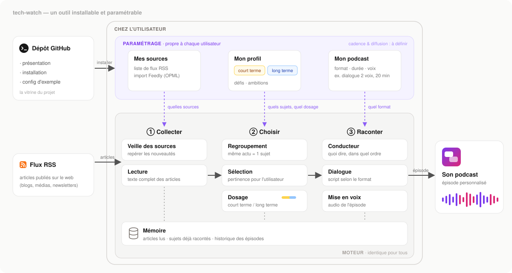

# Architecture — tech-watch

Outil open source à installer et paramétrer : des flux RSS en entrée, un podcast personnalisé en sortie.

- **Paramétrage** (propre à chaque utilisateur) : sources, profil (court / long terme), format du podcast.
- **Moteur** (identique pour tous) : Collecter → Choisir → Raconter, avec une mémoire commune.
- **Règle** : rien de personnel dans le moteur.

À définir plus tard : techniques, cadence, diffusion, forme du paramétrage.
