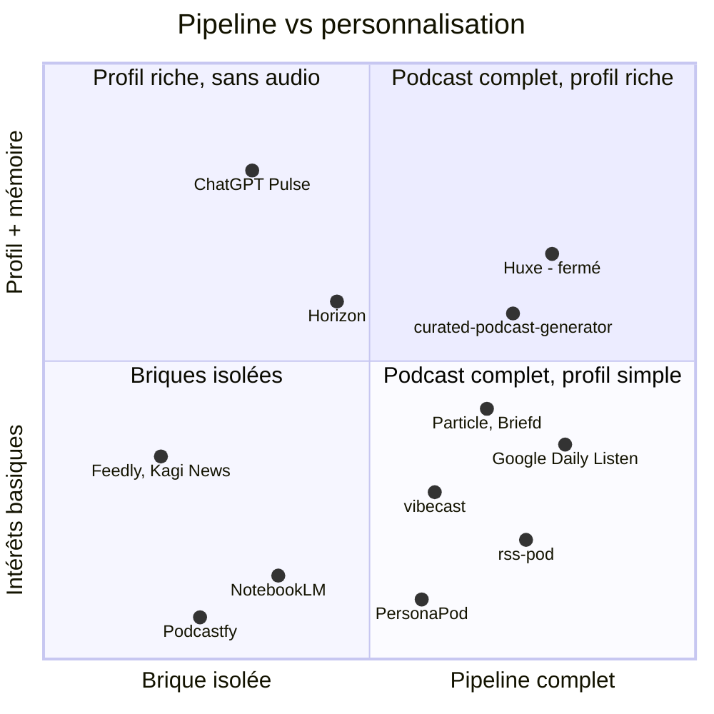
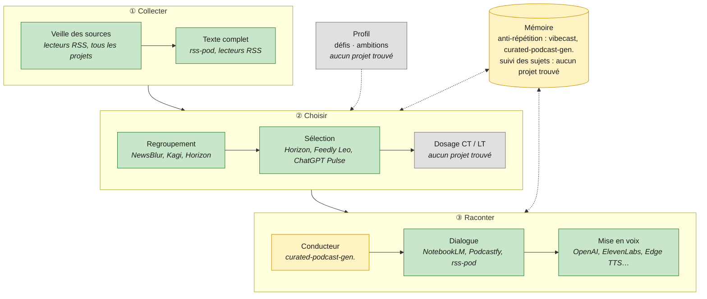

# Paysage — ce qui existe autour de tech-watch

> Relevé factuel du 13/11/2026 : projets open source, applications et grands acteurs qui transforment des flux RSS (ou des actus) en podcast ou en briefing personnalisé. Ce document décrit l'existant ; il ne tranche rien pour le projet.

## En 30 secondes

- 🎙️ **Une dizaine de projets open source** font « flux RSS → podcast IA ». La plupart sont des projets personnels, avec entre 2 et 60 étoiles sur GitHub.
- 🧩 **Chaque étape du moteur de tech-watch est couverte par au moins un projet**, mais par des projets différents.
- 🔍 **Aucun des projets relevés ne combine** un profil court / long terme, un dosage entre les deux et une mémoire qui suit les sujets d'un épisode à l'autre.

## Où se situe chacun

- **Placement approximatif**, d'après les fonctions annoncées par chaque projet.
- **Quart en haut à droite** : Huxe (fermé en mai 2026) et curated-podcast-generator (codé pour une seule région).
- **Projets open source génériques** : tous dans le quart en bas à droite.

## Les étapes du moteur, couvertes par qui

Les étapes de [l'architecture](architecture.md), avec les projets qui les réalisent :

🟩 plusieurs projets · 🟨 un seul projet, ou en partie · ⬜ aucun projet trouvé

## Les plus proches, en détail

| | Collecter | Regrouper | Profil | Dosage | Dialogue | Mémoire | Générique |
|---|:-:|:-:|:-:|:-:|:-:|:-:|:-:|
| [curated-podcast-generator](https://github.com/zirnhelt/curated-podcast-generator) · 2 ★ | 🟩 | 🟩 | 🟨 | 🟨 | 🟩 | 🟩 | ⬜ |
| [Horizon](https://github.com/Thysrael/Horizon) · ~14 k ★ | 🟩 | 🟩 | 🟩 | 🟨 | ⬜ | 🟨 | 🟩 |
| [rss-pod](https://github.com/synrise25/rss-pod) · 60 ★ | 🟩 | ⬜ | 🟨 | ⬜ | 🟩 | ⬜ | 🟩 |
| [vibecast](https://github.com/DomCritchlow/vibecast) · 2 ★ | 🟩 | ⬜ | 🟨 | ⬜ | 🟨 | 🟨 | 🟩 |
| [PersonaPod](https://github.com/treynorman/PersonaPod) · 7 ★ | 🟩 | ⬜ | ⬜ | ⬜ | 🟨 | ⬜ | 🟩 |
| [Podcastfy](https://github.com/souzatharsis/podcastfy) / [Open Notebook](https://github.com/lfnovo/open-notebook) | 🟨 | ⬜ | ⬜ | ⬜ | 🟩 | ⬜ | 🟩 |
| ChatGPT Pulse | 🟨 | 🟨 | 🟩 | ⬜ | ⬜ | 🟩 | ⬜ |
| Huxe *(fermé 05/2026)* | 🟩 | ? | 🟩 | ⬜ | 🟩 | ? | ⬜ |

🟩 fait · 🟨 partiel · ⬜ absent · ? non documenté

Ce que fait chacun, en une ligne

- **curated-podcast-generator** : regroupement, fichier d'intérêts, thèmes hebdo tournants, mémoire de 21 jours, 2 voix, environ 30 min. Contenu codé pour une région du Canada.
- **Horizon** : un profil de pertinence par type de contenu, seuils réglables, assistant qui génère la config, regroupement des doublons. Sortie en texte (Markdown, e-mail, webhook), sans audio.
- **rss-pod** : config YAML, texte complet, filtre LLM optionnel par source, dialogue multi-voix, Docker. Sans profil ni mémoire.
- **vibecast** : actus positives filtrées par mots-clés, épisode d'environ 4 min, aucune histoire répétée sur 7 jours.
- **PersonaPod** : 100 % local, voix clonée, nombre d'articles réglable. Sans sélection par pertinence.
- **Podcastfy / Open Notebook / NotebookLM** : transforment des contenus fournis à la main en dialogue (1 à 4 voix). Pas de veille automatique.
- **personalized-podcast** (442 ★) : skill d'agent qui fait un dialogue à 2 voix à partir d'un contenu fourni, diffusé en flux RSS.
- **ChatGPT Pulse** : briefing quotidien tiré de la mémoire des conversations, en cartes texte, sans audio. Réservé aux abonnés Pro.
- **Huxe** : briefing audio à partir des mails, de l'agenda et des intérêts. Fermé en mai 2026 ; Apple a repris une partie de l'équipe.
- **Google Daily Listen** : épisode de 5 min tiré du flux Discover. Expérimental en 2025, statut actuel inconnu.
- **Particle, Briefd, Daily Rundown, Audexa** : apps grand public de briefing audio ; Daily Rundown accepte aussi des flux RSS perso.
- **Feedly, Inoreader, NewsBlur, Kagi News** : lecteurs et agrégateurs avec tri ou regroupement par IA, sans podcast.

## Faits marquants

| | |
|---|---|
| 📉 **Huxe** | App d'audio personnalisé créée par l'équipe d'origine de NotebookLM. Lancée en 2025, fermée en mai 2026 ; Apple a repris une partie de l'équipe en octobre 2026. |
| ⭐ **Horizon** | Environ 14 000 étoiles et 2 000 forks : de loin le projet le plus suivi du panel. |
| 🏢 **Grands acteurs** | Google (NotebookLM, Daily Listen) et OpenAI (ChatGPT Pulse) proposent ces fonctions dans leurs propres produits. |
| 🧷 **Regroupement** | NewsBlur a ajouté le regroupement d'articles en mars 2026 ; Kagi News et Horizon le font aussi. |
| 📦 **Projets RSS → podcast** | Nombreux, mais la plupart à moins de 60 étoiles et faits par une seule personne. |

Étoiles GitHub relevées le 13/11/2026. Les fonctionnalités viennent des pages GitHub et de la presse ; aucun projet n'a été testé. Le placement dans le diagramme de positionnement est une estimation.
